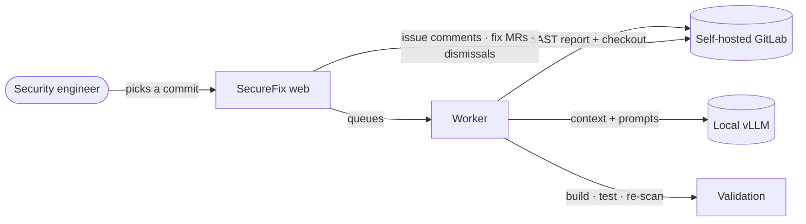

<p align="center">
  <picture>
    <source media="(prefers-color-scheme: dark)" srcset="docs/assets/logo-wordmark-dark.svg">
    
  </picture>
</p>

<p align="center">
  <b>Turn a noisy GitLab SAST report into verified verdicts and tested fixes, with a model that never leaves your network.</b>
</p>

<p align="center">
  
  
  
  
  
  
</p>

---

## What it does

Static analysis finds a lot, and much of it isn't exploitable. Security teams spend their days reading code to
separate the real vulnerabilities from the noise, then writing up the reasoning and the fix.

**SecureFix** does that first pass for you. Pick a commit in your self-hosted GitLab, and SecureFix:

1. **pulls the commit's SAST report**, including Advanced SAST taint traces, and matches each finding to its
   vulnerability record in GitLab;
2. **reads the code that matters** for each finding: the file, the taint path, called functions, callers and
   security configuration, within a token budget;
3. **asks a locally hosted model (vLLM) for a verdict**, several times independently. If the runs disagree, the
   finding goes to a human as *Needs review*;
4. **proposes a fix for real vulnerabilities** and checks it with your project's own build, tests and a re-scan;
5. **lets your team act on it**: post the analysis to the GitLab issue, open a fix merge request, or dismiss a false
   positive, each with the user's own GitLab token.

Nothing is dismissed, merged or posted automatically, and nothing contacts the internet.

## Highlights

| | |
| --- | --- |
| 🔒 **Air-gapped by design** | Runs fully offline: local model, no CDNs, fonts or telemetry. Ships as one bundle of Docker images. |
| 🗳️ **Verdicts by vote** | Independent triage runs; any disagreement becomes *Needs review* instead of a guess. |
| 🧭 **Deep, layered context** | Follows taint traces, definitions and callers instead of showing the model a single line. |
| 🛠️ **Validated fixes** | Fixes are applied, built, tested and re-scanned. A failed validation gets one retry with the error output. |
| ♻️ **No repeated work** | Unchanged findings reuse earlier analyses, and an analysis already posted to GitLab is never posted twice. |
| 👤 **Your permissions, your name** | Every GitLab call uses the acting user's encrypted token; every action is audited. |
| 🛡️ **Prompt-injection aware** | Code containing text addressed to an AI or reviewer is flagged. Prompts and responses are kept for audit. |
| 📊 **Excel reports** | Summary and per-finding sheets with verdicts, fixes, issues, MRs and who posted what. |
| 🏢 **Enterprise sign-in** | Active Directory (LDAP/LDAPS) with group-based access and admin roles, or local accounts. |

## How it works



Each finding ends up as **Real**, **False positive** or **Needs review**, with confidence, reasoning, evidence (source,
sink, mitigations), the code the model saw and, for real findings, a validated diff. See
[How it works](docs/how-it-works.md) for the full pipeline.

## Quick start

> SecureFix's technical name is `vulntriage`: it names the Docker image, bundles, Docker volumes and database, so
> commands and file names below use it.

On a server with internet access, build the bundle:

```bash
scripts/build-and-export.sh 1.2.0
```

On the air-gapped server:

```bash
sha256sum -c vulntriage-1.2.0.tar.gz.sha256
tar xzf vulntriage-1.2.0.tar.gz && cd vulntriage-1.2.0
./install.sh        # loads the images and creates .env
vi .env             # VT_SECRET_KEY, POSTGRES_PASSWORD, VT_GITLAB_URL, VT_LLM_BASE_URL, VT_LLM_MODEL
./install.sh        # starts web, worker and Postgres
```

Open `http://<server>:8080/`. The first account you create becomes the administrator. Each user then adds a GitLab
token under **Settings** and starts from **Analyze Commit**.

### Requirements

- GitLab Ultimate with Advanced SAST (any analyzer producing `gl-sast-report.json` works)
- vLLM with the OpenAI-compatible API
- Docker Engine 24+ with the Compose plugin on the target server; Docker with Buildx on the build server

## Documentation

| | |
| --- | --- |
| [How it works](docs/how-it-works.md) | Architecture, analysis pipeline, triage, fix validation |
| [User guide](docs/user-guide.md) | Analyzing commits, reviewing results, posting, fix MRs, reports |
| [Deployment](docs/deployment.md) | Air-gap bundle, install, HTTPS, upgrades, patches, operations |
| [Configuration](docs/configuration.md) | Environment variables, model settings, token scopes, Windows sign-in, fix validation |
| [Security](docs/security.md) | Credentials, web protections, prompt injection, isolation |
| [Development](docs/development.md) | Local setup, tests, project layout, releasing |

## Tech stack

Python 3.12 · FastAPI · SQLAlchemy · PostgreSQL · Jinja2 with plain JavaScript · vLLM (OpenAI-compatible API) ·
GitLab REST and GraphQL · semgrep · openpyxl · ldap3 · Docker Compose · nginx
