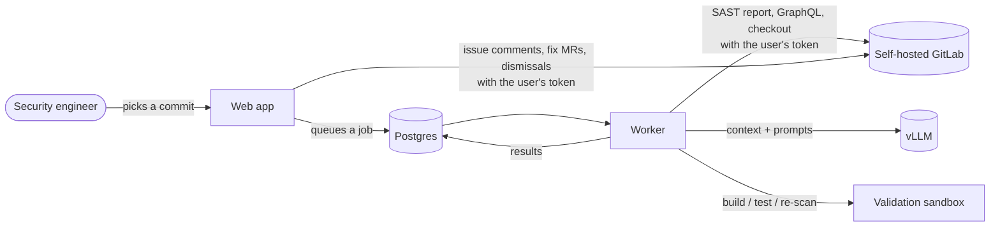
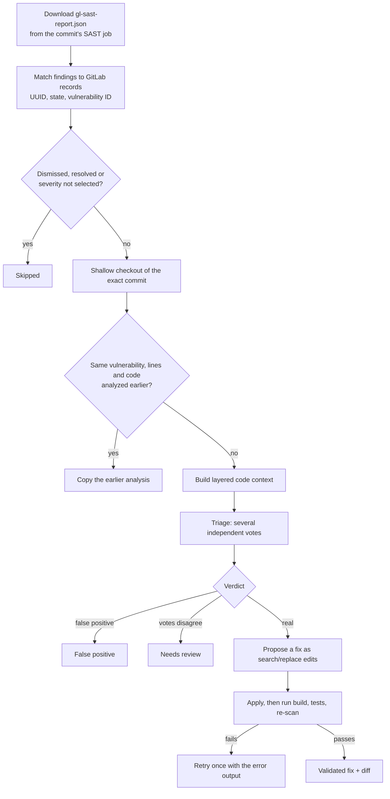

# How it works

SecureFix takes the SAST report GitLab already produced for a commit and works through it finding by finding. A
locally hosted model reads the relevant code and gives a verdict for each finding. For real ones, it also proposes a
fix that is checked by your own build, tests and scanner. People review the results and decide what goes back to
GitLab.

## The analysis pipeline

One analysis ("job") covers one commit of one project. The worker takes it from the queue and runs these steps:

### 1. Report and findings
The worker downloads `gl-sast-report.json` from the commit's SAST job, including Advanced SAST taint traces (code
flows). Through GraphQL it matches each finding to GitLab's vulnerability record, so it knows the finding's UUID,
its state and its vulnerability ID. Findings already **dismissed** or **resolved** in GitLab are skipped, and so are
severities the user didn't select (Critical and High are selected by default).

### 2. Checkout
The exact commit is checked out shallowly. The user's GitLab token is passed to each git command and is never
written to disk.

### 3. Layered context
For each finding, `context_builder.py` collects code in layers until the token budget (*Code per finding* on the Admin page, `VT_CONTEXT_TOKEN_BUDGET` by default) is
used up:

1. the file containing the finding;
2. the files along the taint trace;
3. definitions of the functions it calls;
4. callers of the enclosing function;
5. security-relevant configuration.

If that code contains text addressed to an AI or a reviewer (a prompt-injection attempt), the finding is flagged in the UI.

### 4. Triage by vote
The model is asked for a structured verdict (`true_positive`, `false_positive` or `needs_review`) with confidence,
source, sink, mitigations, reasoning and evidence. This runs `VT_TRIAGE_VOTES` times independently (3 by default).
If the votes disagree, the finding goes to **Needs review** instead of picking a winner. The votes are sent in
parallel, and each is saved as soon as it arrives. Every vote's full answer is kept on the finding, so a reviewer can
compare the runs' arguments.

A person settles a *Needs review* finding. **Confirm as real** sets the verdict and queues the analysis again
for that finding only: it skips triage and goes straight to step 5, using the reasoning of a run that judged it
real. **Mark as false positive** sets the verdict, and dismisses the vulnerability in GitLab when it has a record.
The decision (`reviewed`: who, when, the model's verdict) is copied with the analysis to later scans of the same code.

When a reply is cut off at the token limit, it is retried once with twice the limit. If one vote is still
unreadable, the finding uses the others, with lower confidence.

### 5. Fix and validation
For real findings, the model proposes search/replace edits. These are applied to a copy of the checkout and turned
into a unified diff. Then the project's configured **build**, **test** and **re-scan** commands run (see
[Configuration → Fix validation](configuration.md#fix-validation)). If validation fails, the model gets one retry
with the error output. Without configured commands, fixes are shown as *not validated*.

### 6. Results
Every finished finding and every model call is saved as the job goes. If the worker restarts or is upgraded
mid-job, the analysis resumes from the findings it had not finished.

## Not asking the model twice

There are two ways a finding can reuse earlier work:

- **Copied from an earlier scan**: the same vulnerability (scanner, rule, CWE), file and lines as a finding
  analyzed in an earlier analysis of the same project, with the same code on those lines, in the 10 lines around
  them, and at each taint-trace step. The finding is marked *Copied* and links to the analysis it came from.
- **Exact cache hit**: the whole context, model and prompt version are identical.

Copies only come from analyses made with the same **thinking** setting and the same **code per finding** budget,
so analyzing a commit again with either changed really asks the model, and the two can be compared. An exact cache
hit still applies across budgets: if the finding's code fits both budgets, the model would get the very same prompt.

A copied analysis counts as posted if the analysis it was copied from was posted to GitLab, so the same comment
is never added to an issue twice.

## Human in the loop

Nothing is dismissed, merged or posted automatically. From the results page, a person chooses what to do:

| Action | What happens in GitLab |
| --- | --- |
| Post analysis to GitLab issue | Comments on the finding's issue, creating a confidential issue (assigned to the user) if there is none |
| Open fix merge request | New branch from the analyzed commit, one commit with the fix, MR into the analyzed branch |
| Dismiss as false positive | Dismisses the vulnerability record with the reasoning as comment (default branch only) |

Each of these uses the acting user's own token, so GitLab enforces their permissions. Each one is also recorded on
the finding with who did it.

## Components

| Component | Role |
| --- | --- |
| `web` | FastAPI app: sign-in, settings, admin, commit picker, results, write-back actions, Excel report |
| `worker` | Database-backed job queue; runs analyses in threads (`VT_WORKER_THREADS`), scales with `--scale worker=N` |
| `db` | PostgreSQL: users, encrypted tokens, jobs, findings, model logs |
| `proxy` (optional) | nginx terminating HTTPS |

The pages are rendered on the server and use plain JavaScript with no external assets, so the app works fully offline.
